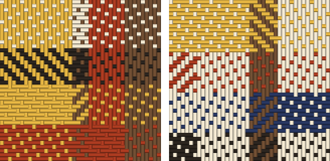

# sett

[](https://github.com/AlinaSchan/sett/actions/workflows/ci.yml)


a sha256 is 64 hex characters, and i am bad at comparing 64 characters by eye. i kept reading checksums four
characters at a time and losing my place. sett weaves the 32 bytes of a digest into a small piece of cloth
instead: the digest sets the widths of the stripes, their dyes and the weave of each block. the same file always
gives the same cloth, and a changed file almost always gives a different one. png or svg, standard library only.



that is `hello` on the left and `hullo` on the right, each with a newline, woven by
`sett --size 8 --compare hello.txt hullo.txt`. one letter changed the whole cloth. [examples](examples) has two
more: the license of this repository and the empty string.

## install

```
pipx install git+https://github.com/AlinaSchan/sett
```

or clone it and run `python -m sett` from the folder. python 3.10 or newer, no dependencies.

## use

```
$ sett LICENSE
e666a4b6ff5433a2b56e9d694dcd189527d02fba12cec49240ac24195f998053  LICENSE
wrote e666a4b6ff54.png (1,004 bytes)
```

the first line has the same form as the output of `sha256sum`. the picture is named after the first 12 hex
digits of the digest and goes into the current folder.

```
$ sett --text ""
e3b0c44298fc1c149afbf4c8996fb92427ae41e4649b934ca495991b7852b855  (text)
wrote e3b0c44298fc.png (1,308 bytes)

$ sett --hex sha256:e3b0c44298fc1c149afbf4c8996fb92427ae41e4649b934ca495991b7852b855
e3b0c44298fc1c149afbf4c8996fb92427ae41e4649b934ca495991b7852b855  (hex)
wrote e3b0c44298fc.png (1,308 bytes)
```

a text is hashed as utf-8. a digest can come with or without `sha256:` in front, in upper or lower case.

```
$ sett --compare hello.txt hullo.txt
5891b5b522d5df086d0ff0b110fbd9d21bb4fc7163af34d08286a2e846f6be03  hello.txt
165e3927cb9dc09c3a04bd2885de5029c8ec7c16ae2f7ff275dee5a1bf2595f3  hullo.txt
the digests differ
wrote 5891b5b522d5-vs-165e3927cb9d.png (2,556 bytes)
$ echo $?
1

$ sett --compare hello.txt copy.txt
5891b5b522d5df086d0ff0b110fbd9d21bb4fc7163af34d08286a2e846f6be03  hello.txt
5891b5b522d5df086d0ff0b110fbd9d21bb4fc7163af34d08286a2e846f6be03  copy.txt
the digests match
wrote 5891b5b522d5-vs-5891b5b522d5.png (1,685 bytes)
```

`--compare` puts both cloths in one picture with a transparent gap between them, and exits with 0 when the
digests match and 1 when they differ, like `cmp`.

```
sett notes.txt photo.jpg          # one picture a file
sett --out pictures notes.txt     # into a folder instead of the current one; it is made if missing
sett --svg notes.txt              # svg instead of png
sett --size 8 notes.txt           # 8 pixels a thread instead of 4: the same cloth, twice as big
sett --ends 20 --picks 60 a.txt   # another number of threads, 40 by 40 unless you say otherwise
```

`--size` takes multiples of 4, because a thread is drawn with four shades across it and only grows by whole
pixels. one cloth stops at 4096 pixels a side.

when an input cannot be used, nothing is written and the exit status is 2:

```
$ sett missing.txt
sett: no such file: missing.txt
sett: nothing written
```

## how it works

- bytes 0 to 7 of the digest cut the warp and the weft into four fields each, one to five parts wide. bytes 8 to
  15 dye each field with one of six dyes: madder, weld, indigo, walnut, undyed and oak gall.
- the fields make 4 by 4 blocks. bytes 16 to 31 give each block its weave: a satin that shows mostly weft, a
  satin that shows mostly warp, or a 2/2 twill, and the direction of its diagonal.
- a thread is 4 pixels wide, a little darker at its edges so it reads as round. 40 ends and 40 picks make a
  picture of 160 by 160 pixels.
- the png is a palette png, written with `zlib` and `struct`: no time, no text, the palette sorted, so the same
  digest gives the same file. the svg lays the warp down in stripes and draws the weft over it where the weft is
  on top. painted, it gives the same pixels as the png.
- it is all integer arithmetic. [the spec](SPEC.md) has every rule and table, one digest worked step by step and
  a list of known answers, enough to weave the same pixels in another language.

## limits

- the picture is a quick visual check. it is not a replacement for comparing the hex. the cloth reads most bytes
  modulo 5 or 6, so at most about 80 of the 256 bits show in it. a changed file almost always weaves a different
  cloth, but with enough computing power someone could make a second file that weaves the same cloth. they could
  not make one with the same sha256. when it matters, compare the hex.
- two different digests can weave the same cloth. if that happens to the two files of `--compare`, it says so:
  "the digests differ, but they weave the same cloth".
- six dyes, and some pairs are close for some eyes. if you do not see red and green well, madder and walnut may
  look alike. the stripes and the weave still differ.
- the png bytes depend on the zlib that python was built with. another zlib may pack the same pixels into other
  bytes. the pixels do not change, and the tests check the pixels.
- sha256 only.

## tests

```
python -m pytest -q
```

the tests pin the pixels of known digests to the numbers of the code this was taken from, read every png back
with a small reader (signature, chunks, crcs, rows), paint the svg in python and compare it with the png pixel by
pixel, and run the command line on files in a temporary folder. they need pytest and nothing else, and no network.

## license

[mit](LICENSE)
